<div align="center">


### Construindo soluções práticas — do software à bancada.

Desenvolvedor independente interessado em transformar problemas reais em ferramentas úteis, testáveis e em constante evolução.

<a href="https://github.com/lucao019">
  
</a>


</div>

---

## Sobre

Crio aplicações desktop, automações e ferramentas que conectam software ao uso cotidiano. Meu foco passa por **Windows, streaming, hardware e IA local**, com atenção à validação no ambiente real e à clareza sobre o que cada recurso faz.

```text
IDEIA  →  PROTÓTIPO  →  TESTES  →  MELHORIA CONTÍNUA
```

## Projeto em destaque

<div align="center">

<a href="https://github.com/lucao019/unknownslab">
  
</a>

### [Unknowns Lab — Control Center](https://github.com/lucao019/unknownslab)

Um centro de controle desktop para reunir overlays, visualização de inputs e diagnóstico local de desempenho em uma experiência integrada.

<a href="https://github.com/lucao019/unknownslab"></a>
<a href="https://nodejs.org/"></a>
<a href="https://dotnet.microsoft.com/"></a>
<a href="https://learn.microsoft.com/windows/"></a>

<br/>

<a href="https://github.com/lucao019/unknownslab">Explorar o projeto →</a>
·
<a href="https://github.com/lucao019/unknownslab/blob/main/CHANGELOG.md">Ver atualizações →</a>

</div>

### O que estou construindo

| Módulo | Destaques |
| --- | --- |
| **Control Center** | Aplicativo desktop modular, navegação integrada e preferências locais. |
| **Streaming & overlays** | Overlay para OBS, visualizadores de teclado e mouse e crosshair configurável. |
| **Movement Lab** | Visualização de curvas e perfis locais, com ativação explícita dos controles. |
| **PUBG Performance Lab** | Diagnóstico do sistema, sensores disponíveis e comparação local de perfis NVIDIA em modo somente leitura. |

> **Estado do projeto:** desenvolvimento ativo. Dados sem fonte validada são apresentados como indisponíveis; diagnósticos de desempenho não prometem ganhos nem alteram configurações do sistema.

## Outros projetos

| Projeto | Descrição | Tecnologias |
| --- | --- | --- |
| [ComfyUI Stack — até 8 GB de VRAM](https://github.com/lucao019/ComfyUI-Stack-8GB-Vram-ou-menos) | Guia e scripts para configurar geração de vídeo com MiniMax H3 em hardware limitado; workflow testado em uma RTX 2060 de 6 GB. | Python · ComfyUI |
| [Assistente de Bancada](https://github.com/lucao019/assistente-bancada) | Assistente de IA local para reparo eletrônico, com análise de imagens, consulta a esquemáticos em PDF e histórico de atendimentos. | Electron · Node.js · SQLite · llama.cpp |
| [CheckIn — Discord Bot](https://github.com/lucao019/discordbotbylucao99999999999) | Bot de check-in de membros com cards de perfil e ferramentas de extração de texto por OCR. | TypeScript · Node.js · discord.js |
| [LUCAO LINK](https://github.com/lucao019/cam-audio-to-windows) | Projeto Android + Windows para transmitir vídeo H.264 do celular pela rede local; recursos de áudio seguem em desenvolvimento. | Java · Node.js · FFmpeg |

<div align="center">

<a href="https://github.com/lucao019?tab=repositories">Ver todos os repositórios →</a>

</div>

---

## Ferramentas e tecnologias

<div align="center">

**Linguagens**

<a href="https://developer.mozilla.org/docs/Web/JavaScript" title="JavaScript"></a>
<a href="https://www.typescriptlang.org/docs/" title="TypeScript"></a>
<a href="https://docs.python.org/3/" title="Python"></a>
<a href="https://learn.microsoft.com/dotnet/csharp/" title="C#"></a>
<a href="https://docs.oracle.com/en/java/" title="Java"></a>
<a href="https://learn.microsoft.com/powershell/" title="PowerShell"></a>

**Aplicações e infraestrutura**

<a href="https://www.electronjs.org/docs/latest" title="Electron"></a>
<a href="https://nodejs.org/docs/latest/api/" title="Node.js"></a>
<a href="https://expressjs.com/" title="Express"></a>
<a href="https://www.sqlite.org/docs.html" title="SQLite"></a>
<a href="https://git-scm.com/doc" title="Git"></a>
<a href="https://docs.github.com/" title="GitHub"></a>
<a href="https://code.visualstudio.com/docs" title="Visual Studio Code"></a>

<br/>

<a href="https://obsproject.com/wiki/" title="OBS Studio">OBS Studio</a>
· <a href="https://ffmpeg.org/documentation.html" title="FFmpeg">FFmpeg</a>
· <a href="https://docs.comfy.org/" title="ComfyUI">ComfyUI</a>
· <a href="https://discord.com/developers/docs/intro" title="Discord">Discord</a>
· <a href="https://developer.android.com/" title="Android">Android</a>

</div>

## Princípios de desenvolvimento

- **Utilidade primeiro:** construir para resolver uma necessidade concreta.
- **Validar antes de afirmar:** distinguir recursos testados, em desenvolvimento e indisponíveis.
- **Transparência técnica:** explicar fontes de dados, limites e comportamento dos módulos.
- **Evoluir com feedback:** prototipar, testar no uso real e aprimorar.

## Atividade no GitHub

<div align="center">


&nbsp;


<br/><br/>


<br/><br/>

<sub>Projetos em evolução contínua: construir, validar no uso real e compartilhar o que funciona.</sub>

</div>
